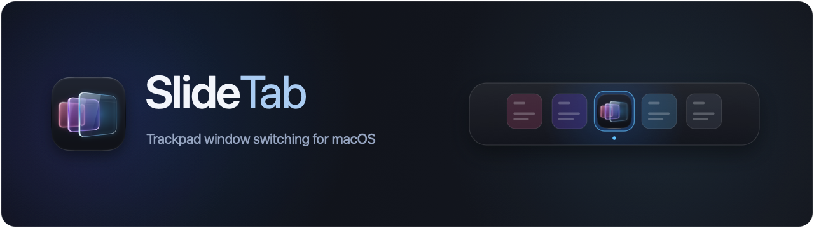

<picture>
  <source media="(prefers-color-scheme: dark)" srcset="https://raw.githubusercontent.com/slidetab/.github/main/assets/readme-banner-dark.png" />
  <source media="(prefers-color-scheme: light)" srcset="https://raw.githubusercontent.com/slidetab/.github/main/assets/readme-banner-light.png" />
  
</picture>

Trackpad window switching for macOS. Rest 4 or 3 fingers on a MacBook trackpad or Magic Trackpad, slide to pick a window or coding agent session, and lift.

Written in native Swift for macOS 14 Sonoma and later. It runs at 0.0% idle CPU, asks only for Accessibility (no Screen Recording), and sends no analytics.

## Install

Download the notarized DMG from [slidetab.app](https://slidetab.app), or install with Homebrew:

```bash
brew install --cask slidetab/tap/slidetab
```

Basic window-switching gestures are free forever. SlideTab Pro is a one-time purchase ($9 for 1 Mac, or $59 for a 10-Mac Team pack).

## Repositories

- **[slidetab/slidetab](https://github.com/slidetab/slidetab)**: Bug reports, feature requests, and public docs
- **[slidetab/homebrew-tap](https://github.com/slidetab/homebrew-tap)**: Official Homebrew cask (`slidetab/tap/slidetab`)

Questions or support: [denis@slidetab.app](mailto:denis@slidetab.app)
